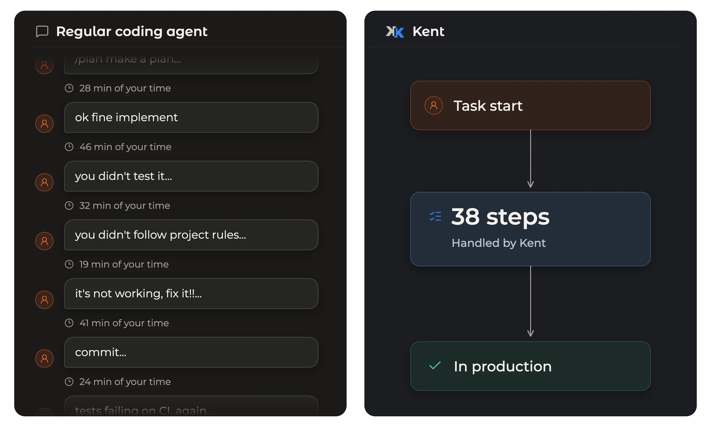
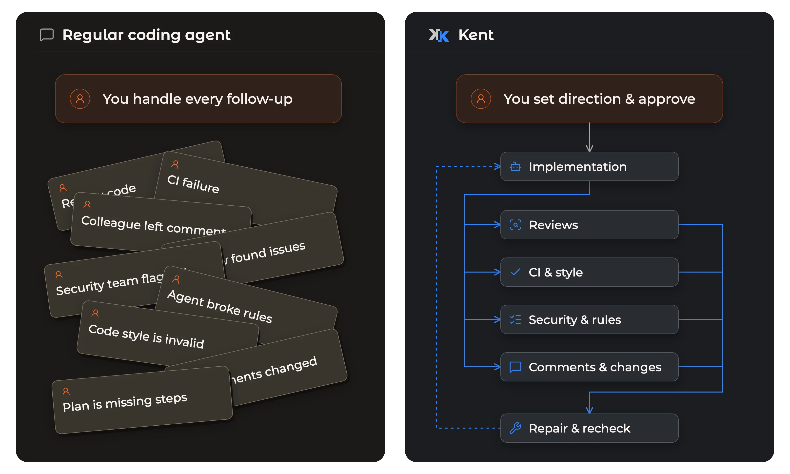
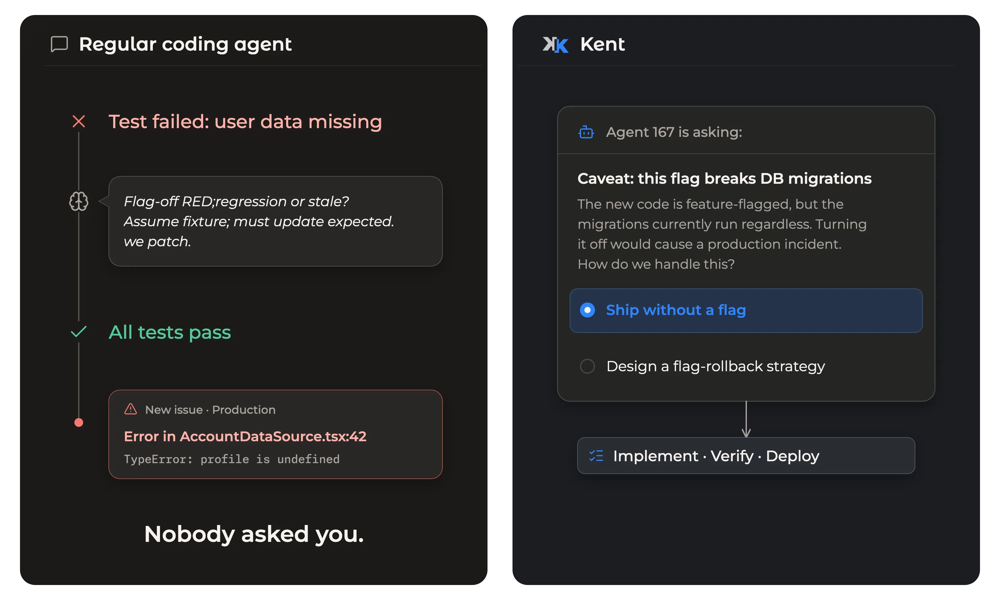
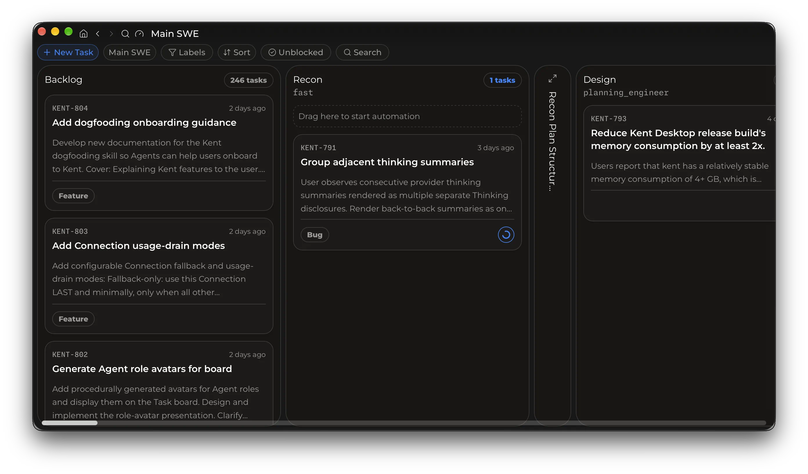
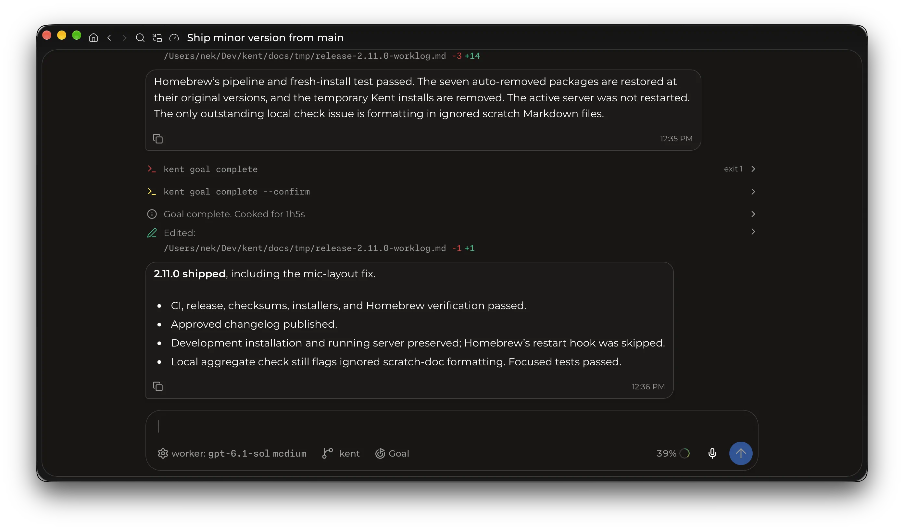

  

<h1 align="center">Kent</h1>

  <a href="https://kent.sh/quickstart/">🚀 Quickstart</a>
  ·
  <a href="https://kent.sh/docs/">📖 Docs</a>
  ·
  <a href="https://github.com/respawn-llc/kent/releases">📦 Releases</a>

<strong>Kent</strong> (Russian: Кент, [kʲent]) - prison slang for “bro”.

Kent is a new approach to agentic SWE that allows you to let agents take over the **entire process** of building software - from idea to production deployment - **without human involvement**. It's a way to build enterprise-grade, high-quality, tested, reviewed, deployed software while humans focus on **making decisions** - what we do best.

### Stop babysitting agents

Regular coding agents require you to manage every step the agent takes - planning, subagents, verification, CI, review, goals, design, approvals, and more. Kent allows you to ensure quality code is shipped without your constant supervision.

### Automate SWE with Agentic Graphs

LLMs are non-deterministic. Agents break rules, ship slop, skip verification, lie about results, hallucinate, and make harmful assumptions in pursuit of rewards and benchmark scores. **Kent gives you a way to prevent that.** Design automated, cyclic graphs for your entire SWE process, receiving only production-ready, enterprise-grade software as output.

### The opposite of vibe-coding

Humans’ job is decision making, which is hard enough, so let Kent do the rest. Transition to being a **manager** instead of reviewing code, fixing issues, looking for slop, or doing manual QA.

Kent is how **serious software engineering** is done with agents.

### Scale to hundreds of agents

After you start using Kent, you will realize you can now ship 10x as much software at higher quality than ever before. You will become **hungry for more**.

Kent is a combination of a desktop app, a remote server, a traditional TUI, and a CLI - with UX designed to enable you to manage a **hundred parallel agents at once**.

And the best part? You no longer need frontier models when you can delegate easy work to local models and hard work to cheap, fast models, which will verify and fix it - instead of hoping the model does it right.

### Everything you expect from a coding agent

Kent supports your existing token subscriptions (when you inevitably want more), comes with a great traditional chat UX, great performance (20 MB of RAM per agent), and a custom harness optimized for SWE, collaborative work, and token efficiency. Kent workers complete goals, work overnight, use worktrees, and talk to each other without your supervision.

Still not convinced? Full list of features:

- Agentic Graphs (aka workflows).
- Visual graph editor.
- Agent-assisted workflow authoring.
- Workflow validation.
- Conditional workflow transitions.
- Parallel workflow branches and joins.
- Review and repair loops.
- Human approval gates.
- Questions, answerable by agents and humans.
- Script nodes for graphs.
- Structured outputs between workflow steps.
- Per-step agent roles and reasoning levels.
- Agent-selected roles and reasoning at serial workflow handoffs.
- Fresh, continued, and compacted context between workflow steps.
- Supervisor review of agent work and follow-up suggestions.
- Custom subagent roles.
- Asynchronous subagent delegation.
- Subagent steering and continuation.
- Configurable subagent delegation depth.
- Persistent goals with automatic follow-up turns.
- Automatic wake-ups after background processes finish.
- Proactive compaction to let agents choose when they hand off the work.
- Speculative compaction to save tokens and keep the cache warm.
- Active-request carryover during compaction.
- Manual compaction with custom instructions.
- Context-window usage tracking.
- Context-aware runtime reminders.
- Prompt-cache-aware configuration snapshots.
- Cache-miss diagnostics with token estimates.
- Asynchronous shell execution.
- Parallel shell processes.
- Concurrent model-issued tool calls.
- Interactive shell input.
- Full, file-backed shell output logs.
- Model-compatible patch and edit tools.
- Built-in shell output optimization (a la rtk).
- Custom shell post-processing hooks (to use tools such as rtk).
- Optimized repository search through ripgrep.
- Kent-managed Git worktrees.
- Project-specific worktree setup.
- Workflow-selected worktree creation.
- Multi-project task management.
- Kanban task boards.
- Project-wide task lists across workflows.
- Task dependencies.
- Task labels and board filters.
- Cross-project task search.
- Task comments and activity.
- Manual task transitions.
- Desktop notification inbox and notifications from agents.
- Headless runs through the CLI.
- Structured JSON output for headless automation.
- Task and session observation through CLI wait/watch commands.
- Global, project, and private configuration.
- Custom agent system prompts.
- Global and project AGENTS.md instructions.
- Skills and reusable slash commands.
- Skill and command imports from Claude Code, Codex, Cursor, and Grok.
- Per-agent models, connections, tools, and reasoning levels.
- Multiple provider connections and account load balancing.
- Session-sticky provider connections with load balancing.
- Automatic failover on exhausted quotas or credits.
- Subscription usage and reset displays.
- Detailed tool-input and output transcripts.
- Message steering and queuing.
- Conversation editing and forking.
- Saved-session resumption.
- Prompt history.
- Built-in code review.
- Image and PDF viewing for multimodal models.
- Native web search with supported providers.
- Desktop speech-to-text dictation using subscription allowance.
- Native desktop chat windows.
- Clipboard image input.
- Light, dark, and system themes.
- Automatic session naming.
- Lifecycle hooks for notifications and integrations.
- Background server service.
- Remote server connections.
- Server deployment in containers or VMs.
- Work running independently of connected clients.
- Operating-system sleep prevention during active work.

### Installation

Kent is FOSS and takes 10 minutes to get started with. Follow the [Quickstart](https://kent.sh/quickstart/) guide to try it.

**Platforms:** macOS (Apple Silicon), Linux and Windows (x64). Server and TUI also support Linux and Windows ARM64.

### Models and subscriptions

**Subscriptions**

| Supported | In progress | Against ToS |
| --- | --- | --- |
| ChatGPT | OpenCode | Claude |
| Grok Build | DeepSeek Coding Plan | Gemini |
| GLM Coding Plan | Kimi Coding Plan | Muse Code |

**API access:** OpenAI, xAI, DeepSeek, and OpenAI Responses-compatible endpoints, including local model servers.

See [authentication and connections](https://kent.sh/authentication/) for setup.

### License

[AGPL-3.0-only](https://github.com/respawn-llc/kent/blob/main/LICENSE).
